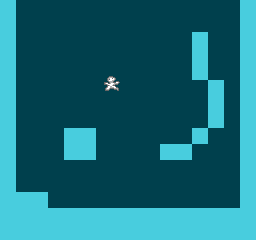

# NES Assembly Experiment

This repo contains the source code for a cool little 2D platformer
that I'm developing as a way to practice NES programming.

Not tested on real hardware because I don't have an NES.

## Learning Material

Here are some of the resources that I've used while making this

- [Minimal NES example using ca65](https://github.com/bbbradsmith/NES-ca65-example/tree/master).
- [NESWiki](https://www.nesdev.org/wiki/Nesdev_Wiki).
